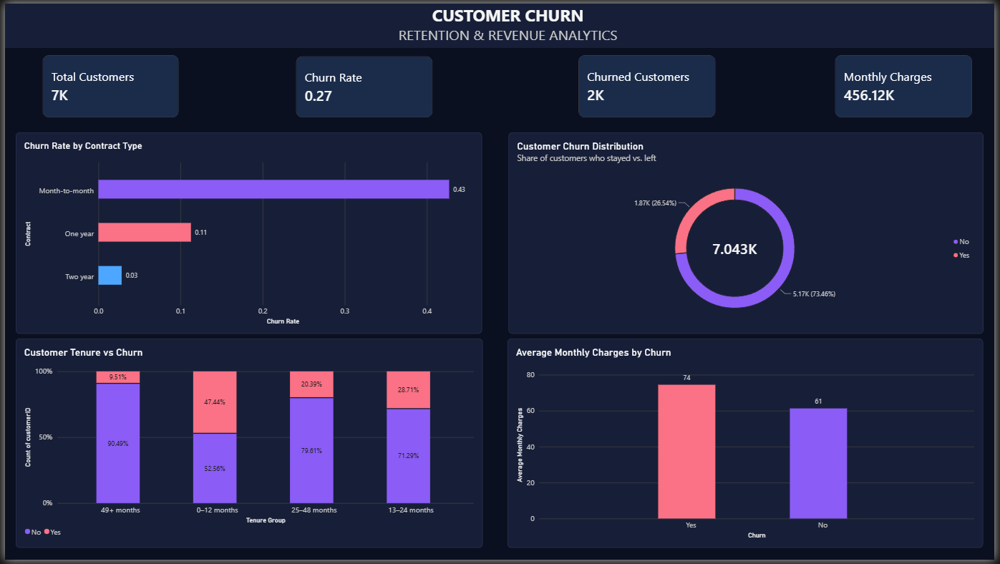

# Customer Churn & Retention Analysis | Power BI

## Project Overview
An interactive Power BI dashboard designed to analyze customer churn, explore retention patterns, and understand factors associated with customers leaving a service.

## Objectives
- Analyze overall customer churn and retention.
- Compare churn across contract types and tenure groups.
- Explore churn patterns by internet service, payment method, and customer support.
- Present insights through KPIs and interactive visualizations.

## Tools & Technologies
- Microsoft Power BI
- Power Query
- DAX (Data Analysis Expressions)
- Data Visualization

## Dashboard Pages
1. **Overview:** Customer KPIs, churn distribution, and contract comparisons.
2. **Customer Analysis:** Tenure groups and customer-segment analysis.
3. **Services Analysis:** Internet service, payment method, and contract patterns.
4. **Churn Insights:** Analysis of tenure, monthly charges, support services, and customer segments.

## Dashboard Preview

### Overview

### Customer Analysis

### Services Analysis

### Churn Insights

## Dataset
Telco Customer Churn dataset, containing customer information, subscribed services, contract details, billing information, and churn status.

## Key Findings
Add your actual findings after checking the completed dashboard. Include the customer segments with the highest churn rates and any important retention patterns.

## Repository Contents
- Power BI report (`.pbix`)
- Dashboard screenshots
- Project documentation (`README.md`)

## How to View
Download the Power BI report and open it in Microsoft Power BI Desktop.

## Author
Garima Pandey
